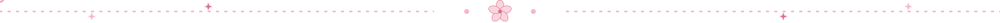
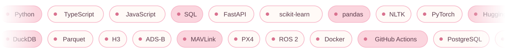

**Data Science and AI engineer** 🌸 United Arab Emirates (Dubai and Abu Dhabi)

## About me 🌷

I am an AI engineer based in the United Arab Emirates. I build systems that report what they know and also what they do not know. In practice that means calibrated confidence, abstention when the evidence is thin, and evaluation that is pre registered, so the results can be checked and not just believed.

My work sits where data science meets physical systems: GNSS interference, drone operations, building cooling, address resolution for Gulf cities, and early warning from real satellite data. I care about the unglamorous parts too, such as failure states, provenance and honest wording, because a result is only useful when a stranger can trust it.

Every project below states plainly what is real, what is synthetic and what is still a proposal.

## Selected work 🌸

Each row says what the project does and how far it has gone. Synthetic results are labelled as synthetic, and nothing here is presented as a deployment.

### 🌸 Signal and position integrity

| Project | What it does | Status |
| --- | --- | --- |
| [**tashwish**](https://github.com/hudasol/tashwish) ([dashboard](https://tashwish.onrender.com)) | Gulf GNSS interference observatory. An open pipeline, dashboard and read only API that map jamming like and spoofing like anomalies in public ADS-B data, using H3 cells, DuckDB and Parquet. Receiver coverage is modelled, so cells nobody can see are marked as insufficient data and never as quiet. Held out days were fixed before scoring and scored once: 19 hits, 8 misses and 1 not evaluable out of 28 predictions. | Release candidate, Apache 2.0 code, ODbL data |
| [**marsad**](https://github.com/hudasol/marsad) | Position trust layer for autonomous systems. Detects GNSS jamming and spoofing, scores track integrity across sources and recommends fallback navigation. Built for PX4 and MAVLink and ready for MCP. | Open source, Apache 2.0 |
| [**signal-anomaly-detection**](https://github.com/hudasol/signal-anomaly-detection) | Anomaly detection and early warning for simulated fleet telemetry. A rule baseline against a fast path residual detector, with no LLM in the decision path. | 195 tests, simulated data |

### 🌷 Robots, drones and physical systems

| Project | What it does | Status |
| --- | --- | --- |
| [**sirb**](https://github.com/hudasol/sirb) ([live viewer](https://hudasol.github.io/sirb/)) | Simulation first multi drone show planner. Plans polynomial trajectories, proves minimum separation exactly with an independent second verifier, then stress tests each plan by Monte Carlo for GNSS error, wind and failures. Bilingual English and Arabic 3D viewer. Not flight certified. | Apache 2.0, live viewer |
| [**dhill**](https://github.com/hudasol/dhill) | Dhill (ظل, "shade"). A GO, DERATE or PARK decision tool for outdoor operations, with exceedance probability, time to limit and a battery ageing scheduler. | Open source |
| [**dune-rover**](https://github.com/hudasol/dune-rover) | Simulation and pre registered field protocol for rover traversability on Arabian linear and star dunes, predicted from open elevation data. Published, simulated and planned results are kept apart. | Simulation and protocol |
| [**post-quantum-security**](https://github.com/hudasol/post-quantum-security) | A sourced review of what post quantum cryptography costs on drone and robot microcontrollers, with a link simulator, a fleet migration planner and a free benchmark plan. | Research and tools |
| [**sightline**](https://github.com/hudasol/sightline) | Advisory video perception for indoor inspection robots: person detection, multi object tracking and one event per corridor crossing, with leakage safe evaluation and honest degraded states. | In progress, MIT |
| [**dhamaan**](https://github.com/hudasol/dhamaan) | Robot and drone safety assurance research. | Research |

### 🍋 Infrastructure, health and public sector data

| Project | What it does | Status |
| --- | --- | --- |
| [**delta-t-doctor**](https://github.com/hudasol/delta-t-doctor) | Diagnoses low delta T in district cooling from utility meter data alone, with ranked causes, tiers, gain intervals, a penalty calculator and an open benchmark. Validated on simulated buildings only. | MIT, synthetic validation |
| [**tahdeed**](https://github.com/hudasol/tahdeed) | Bilingual Arabic and English address resolver for Gulf cities. It handles Arabizi, gives a calibrated confidence score and abstains when an address is too ambiguous. Ships with Gulf AddressBench. | v2.0.0, MIT |
| [**nadhir**](https://github.com/hudasol/nadhir) | Early warning hindcast for harmful algal blooms, using real historical satellite data only (Sentinel 3 OLCI and MODIS Aqua) and a blind evaluation protocol. | Hindcast evidence |
| [**hawiyya**](https://github.com/hudasol/hawiyya) | Duplicate patient record finder for Arabic, English and Arabizi name variants. It abstains when it is unsure. | Apache 2.0 |
| [**sikka**](https://github.com/hudasol/sikka) | Road crash and traffic data contract checker with blackspot ranking. | Apache 2.0 |
| [**sepsis-6q**](https://github.com/hudasol/sepsis-6q) | A prespecified, matched benchmark of a quantum kernel SVM against classical models for early sepsis warning on PhysioNet 2019 ICU data, with an entanglement control and quantum resource reporting. Built for the Qiskit Fall Fest 2026. | Apache 2.0 |
| [**ikhtibar**](https://github.com/hudasol/ikhtibar) | A comparative evidence base on testing AI systems before deployment: what governments and institutes require, recommend or only describe. Includes a UAE gap analysis, an assurance checklist and a small command line self assessment tool. Research, not legal advice. | Research |
| [**taadeel**](https://github.com/hudasol/Taadeel) | A tracker for changes in UAE legislation. | Apache 2.0 |

### 🌿 Live demos

| Project | What it does | Status |
| --- | --- | --- |
| [**mutabaa**](https://mutabaa-adeoi.vercel.app) ([code](https://github.com/hudasol/mutabaa)) | A verifiability workbench for UAE AI transformation targets. It turns headline commitments into evidence linked ledgers. Synthetic data, labelled as such. | Live on Vercel |
| [**madoun**](https://madoun.vercel.app) ([code](https://github.com/hudasol/madoun)) | A shared evidence file for faster, explainable customs clearance in Abu Dhabi, with a robot ready inspection seam. All results are synthetic and modelled. | Live on Vercel |
| [**island-echoes**](https://island-echoes.onrender.com) ([code](https://github.com/hudasol/island-echoes)) | A 3D globe of seven remote islands. Endangered and extinct creatures answer as field agents, only from cited NASA POWER, GBIF and island fact file sources. | Live on Render |

More work is in progress across robotics, language models and safety assurance. It will appear here once there is something worth showing.

## How I work 🍋

My evaluation loop is deliberately strict, because a clever result that cannot be checked is only an opinion.

| Principle | In practice |
| --- | --- |
| Predictions before results | Hypotheses are written and committed before each run, then scored as hits or misses. |
| Held out data is touched once | Splits, models and thresholds are frozen first. The test set is scored a single time, and a guard refuses a second run. |
| Misses are published | Failed predictions stay in the table beside the successes, so the record is candid and not flattering. |
| Honest data labels | Synthetic data is labelled synthetic everywhere. No claim of transfer without real validation. |
| Calibration and abstention | A system should be allowed to say that it does not know. |
| Explicit failure states | A service answers unavailable, insufficient data or degraded when that is the truth. It never says normal without a score. |
| Reproducibility | Fixed seeds, pinned environments, one command to rerun, and numbers that come from code. |
| Sources are opened before they are cited | A reference enters a bibliography only after I have read it. |
| Careful wording | A result is phrased at the strength of its evidence, for example "passed the specified separation check" and not "verified plan". |
| Proposals stay proposals | Work aimed at government or industry is framed as a proposal seed, never as a deployment. |

## Toolbox 🌿

**Languages**

**Machine learning and evaluation**

**Data and geospatial**

**Robotics and autonomy**

**Backend and delivery**

**Frontend and 3D**

**Quality and research practice**

**Focus areas:** GNSS and signal integrity, drone and robot safety, anomaly detection, calibration and uncertainty, preregistered evaluation, geospatial analysis, remote sensing, district cooling analytics, Arabic language processing, edge ML, post quantum cryptography, evaluation harnesses and benchmarks.

## Activity 🌸

## Get in touch 🌷

I am open to conversations about research collaborations, applied AI for infrastructure and autonomy, and proposals with UAE organisations. If you have a hard problem where being honest about uncertainty matters, I would very much like to hear about it.

- LinkedIn: [Huda Mueen](https://www.linkedin.com/in/huda-mueen-73bba6363/)
- Email: [hudamueen2407@gmail.com](mailto:hudamueen2407@gmail.com)
- GitHub: [hudasol](https://github.com/hudasol)
- Location: United Arab Emirates (Dubai and Abu Dhabi)

