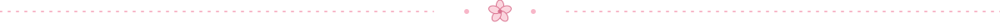

**Data Science and AI engineer** 🌸 United Arab Emirates (Dubai and Abu Dhabi)

## About me 🌷

I am an AI engineer based in the United Arab Emirates. I build systems that report what they know and also what they do not know. In practice that means calibrated confidence, abstention when the evidence is thin, and evaluation that is pre registered, so the results can be checked and not just believed.

My work sits where data science meets physical systems: GNSS interference, drone operations, building cooling, address resolution for Gulf cities, and early warning from real satellite data. I am also a cofounder and CTO of Kanban Studios, where I build products end to end.

Every project below states plainly what is real, what is synthetic and what is still a proposal.

## Selected work 🌸

| Project | What it does | Status |
| --- | --- | --- |
| [**marsad**](https://github.com/hudasol/marsad) | Gulf GNSS interference observatory. Detects and maps jamming and spoofing signals from open ADS-B data, using H3 cells and DuckDB with Parquet. | Open source, Apache 2.0 |
| [**tahdeed**](https://github.com/hudasol/tahdeed) | Bilingual Arabic and English address resolver for Gulf cities. It abstains when the evidence is weak and handles Arabizi. Ships with Gulf AddressBench. | v2.0.0, MIT |
| [**delta-t-doctor**](https://github.com/hudasol/delta-t-doctor) | Diagnoses low delta T in district cooling, with ranked causes, tiers and gain intervals. Validated on simulated buildings only. | MIT, synthetic validation |
| [**dhill**](https://github.com/hudasol/dhill) | Dhill (ظل, "shade"). A GO, DERATE or PARK decision tool for outdoor operations, with exceedance probability, time to limit and a battery ageing scheduler. | Open source |
| [**signal-anomaly-detection**](https://github.com/hudasol/signal-anomaly-detection) | Anomaly detection and early warning for simulated fleet telemetry. A rule baseline against a fast path residual detector, with no LLM in the decision path. | 195 tests, simulated data |
| [**sightline**](https://github.com/hudasol/sightline) | Perception for indoor inspection robots. | In progress |
| [**mutabaa**](https://mutabaa-adeoi.vercel.app) | Live demo. Synthetic data, labelled as such. | Live on Vercel |
| [**madoun**](https://madoun.vercel.app) | Live demo. All results are synthetic and modelled. | Live on Vercel |
| [**island-echoes**](https://island-echoes.onrender.com) | Live interactive project. | Live on Render |

Further work in progress covers sand and dune mobility for rovers, post quantum security for drones and robots, and Gulf address data. These will appear here once there is something worth showing.

## How I work 🍋

| Principle | In practice |
| --- | --- |
| Predictions before results | Hypotheses are written and committed before each run, then scored as hits or misses. |
| Honest data labels | Synthetic data is labelled synthetic everywhere. No claim of transfer without real validation. |
| Calibration and abstention | A system should be allowed to say that it does not know. |
| Reproducibility | Fixed seeds, one command to rerun, and numbers that come from code. |
| Proposals stay proposals | Work aimed at government or industry is framed as a proposal seed, never as a deployment. |

## Toolbox 🌿

**Focus areas:** GNSS and signal integrity, drone and robot safety, anomaly detection, calibration and uncertainty, geospatial analysis, district cooling analytics, edge ML, post quantum cryptography, evaluation harnesses and benchmarks.

 
## Activity 🌸

## Get in touch 🌷

I am open to conversations about research collaborations, applied AI for infrastructure and autonomy, and proposals with UAE organisations.

- LinkedIn: [Huda Mueen](https://www.linkedin.com/in/huda-mueen-73bba6363/)
- Email: [hudamueen2407@gmail.com](mailto:hudamueen2407@gmail.com)
- Location: United Arab Emirates (Dubai and Abu Dhabi)
